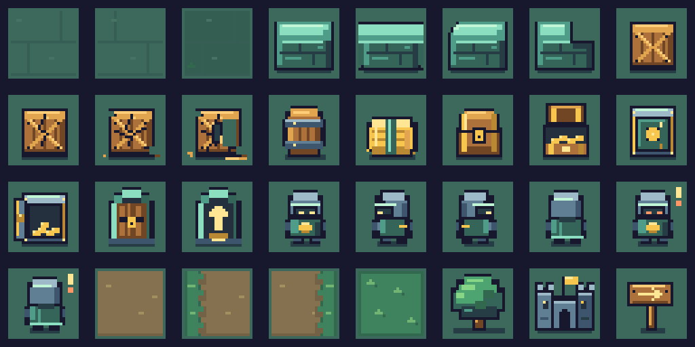

# Cenário arcade OUTLAWS

Proposta original de cenário em pixel, com blocos de leitura rápida e o mundo de madeira, floresta, cofres e guardas do OUTLAWS. A referência é a clareza de uma grade arcade vista de cima. Nenhum asset de outro jogo foi copiado.

## Arquivos e uso

- `scenario.png`: folha RGBA de 192 × 96, oito colunas e quatro linhas, 32 células exatas de 24 × 24.
- `scenario.json`: nomes, índices, retângulos, função, estado, direção, ponto de apoio e área ocupada de cada tile. `frames[nome]` é a tabela principal; `order` preserva a ordem dos 32 slots.
- `scenario-preview.png`: galeria para conferência, ampliada quatro vezes com pixels inteiros e fundo igual ao piso. Não usar como spritesheet.
- `tools/draw-arcade-scenario.cjs`: desenho reproduzível com Node e o helper `tools/arcade-pixels.cjs`, sem dependências instaladas.

Paleta com 30 cores visíveis, contorno `#17182d`, pedra e guardas em teal, madeira quente e dourado nos objetivos. O piso usa duas juntas baixas e dois pontos de luz; os objetos recebem o contraste principal. Sombras, contornos e pixels ficam dentro da própria célula. A sombra final é opaca; a folha usa apenas alfa 0/255.

## Índices

| Índice | Nome | Uso |
| --- | --- | --- |
| 0 | `floor_a` | Piso discreto |
| 1 | `floor_b` | Variação das juntas |
| 2 | `floor_c` | Piso com musgo |
| 3 | `wall_center` | Bloco indestrutível com topo e frente |
| 4 | `wall_edge` | Parede conectada, orientação canônica norte |
| 5 | `wall_corner_outer` | Canto externo, orientação noroeste |
| 6 | `wall_corner_inner` | Canto interno, recesso nordeste |
| 7 | `crate` | Caixa intacta |
| 8 | `crate_damage_1` | Caixa com primeira rachadura |
| 9 | `crate_damage_2` | Caixa com rachaduras e lascas |
| 10 | `crate_damage_3` | Caixa com tábua ausente e lasca maior no chão |
| 11 | `barrel` | Barril com aros metálicos |
| 12 | `hay` | Feno com faixa teal |
| 13 | `chest_closed` | Baú fechado |
| 14 | `chest_open` | Baú aberto |
| 15 | `vault_closed` | Cofre fechado |
| 16 | `vault_open` | Cofre aberto |
| 17 | `exit_closed` | Saída fechada |
| 18 | `exit_open` | Saída aberta, seta indicando o estado |
| 19 | `guard_front` | Guarda encapuzado com elmo, olhando para baixo |
| 20 | `guard_left` | Guarda olhando para a esquerda |
| 21 | `guard_right` | Guarda olhando para a direita |
| 22 | `guard_up` | Guarda de costas |
| 23 | `guard_front_alert` | Guarda frontal em alerta |
| 24 | `guard_up_alert` | Guarda de costas em alerta |
| 25 | `road_center` | Centro da estrada |
| 26 | `road_edge_left` | Estrada com margem de grama à esquerda |
| 27 | `road_edge_right` | Estrada com margem de grama à direita |
| 28 | `grass` | Grama baixa |
| 29 | `tree` | Árvore com copa e tronco |
| 30 | `castle` | Castelo de duas torres para a vinheta da estrada |
| 31 | `signpost` | Placa de madeira decorativa |

Os guardas laterais em alerta são composições descritas em `composites`: desenhar `guard_left` ou `guard_right` e o pequeno marcador do tile `guard_front_alert`, recorte local `{x:20,y:0,w:4,h:8}`, na posição local `{x:20,y:0}`. Assim há quatro direções e duas condições sem ultrapassar 32 slots.

## Integração e portabilidade

O ponto de apoio comum é `{x:12,y:22}`. Pisos preenchem 24 × 24; props mantêm transparência ao redor. Para a célula original de 32 px, centralizar a arte nativa de 24 px e usar o piso/contorno do módulo visual no restante da célula. Evitar esticar o tile para 32 px com escala fracionária.

Escolher a caixa rachada, baú/cofre aberto, guarda em alerta e saída aberta somente pelo estado que já existe no jogo. A seta da saída é um indicador de estado e não anuncia uma ação de clique. O desenho não atribui efeitos, vida, dano, recompensas ou novos estados aos objetos.

Paredes possuem quatro variantes para o módulo escolher pela vizinhança. As variantes de borda e canto têm orientação canônica no JSON e podem ser giradas em quartos de volta, quando necessário. A seleção da parede continua apenas visual.

Portar para a origem do JP: levar os PNG/JSON a uma pasta de propostas em assets, o gerador e seu helper a tools, e o uso da folha ao módulo visual adicional em `panel/`. Não substituir `lib/mapart.js`, `lib/sprite.js` ou a arte atual do JP. O caminho exato do módulo em `panel/` depende da organização da origem, que não está nesta cópia.

## Conferência

- `node --check tools/draw-arcade-scenario.cjs` passou.
- `node tools/draw-arcade-scenario.cjs` gera a folha e valida 32 nomes únicos, piso preenchido, grade inteira e células com arte.
- PNG confirmado como 192 × 96, 8 bits por canal, RGBA; retângulos das 32 entradas coincidem com a grade 8 × 4.
- Preview inspecionado: contraste entre piso e props, direção dos quatro guardas, progressão das três rachaduras e distinção entre baú/cofre/saída abertos e fechados.
- Revisão da caixa no último estágio: 58 pixels alterados somente em `crate_damage_3`, com abertura de uma tábua para leitura em 1x. Os outros 31 frames, grade de 24 px e apoio em y=22 foram comparados e permaneceram iguais.

Esta frente acrescenta apenas o gerador e os arquivos de cenário descritos acima. Nenhum JS do jogo, HTML, ABI, carteira ou lógica de transação foi editado nesta rodada.
